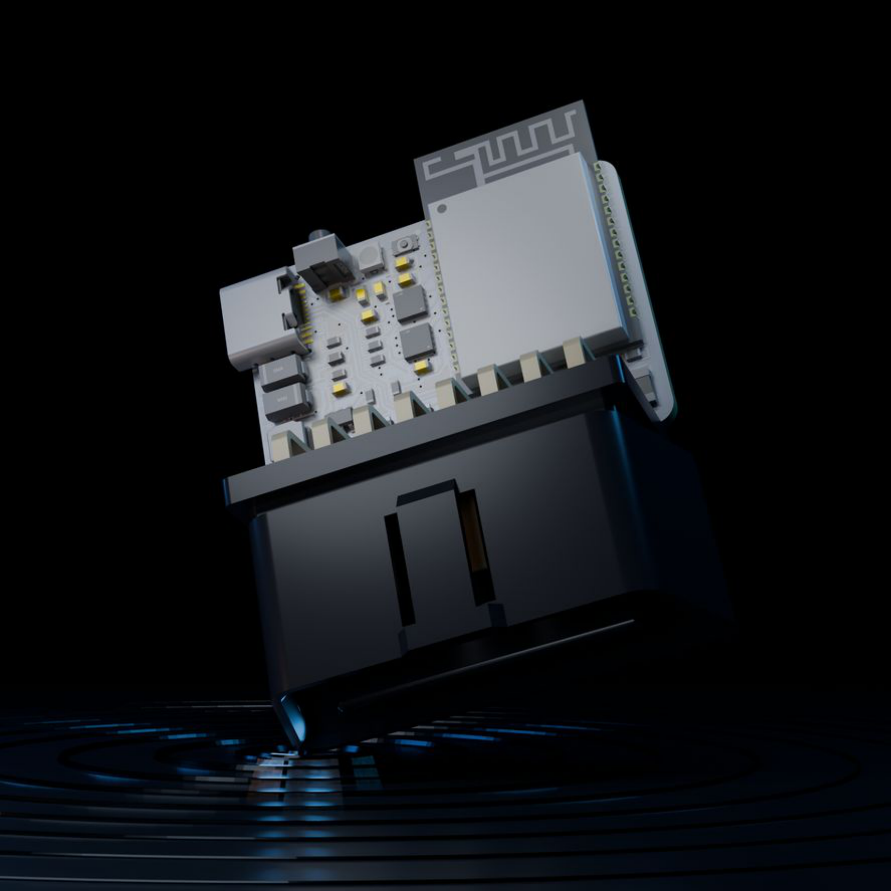

# CANOpener OBD SE

Dual CAN bus OBD-II interface for vehicle networks. Standard Edition, Hardware Revision A.

CANOpener OBD SE is a compact dual CAN bus interface that plugs into a vehicle OBD-II (OBD2) diagnostic port. It connects to two independent CAN buses and supports Classical CAN and CAN FD at up to 5 Mbps.

The board is built around an Espressif ESP32-C5-WROOM-1-N8R8 with two Texas Instruments TCAN3414 CAN transceivers. It includes onboard voltage regulation, input and CAN bus protection, an addressable RGB status LED, Boot and Reset controls, and a wireless antenna. Power it from the vehicle or from USB-C.

Order from the CAN Opener store.

Select model **CO-SE-NEXUS** to install or restore stock firmware. The latest version is selected by default. Use Chrome, Edge, or Firefox on a computer.

## Documentation

- [Hardware specifications](docs/hardware.md)
- [Hardware documentation PDF](docs/CANOpener-SE-Hardware-Documentation.pdf)

## Specifications

|                   |                                       |
| ----------------- | ------------------------------------- |
| MCU               | Espressif ESP32-C5-WROOM-1-N8R8       |
| CAN transceivers  | 2× Texas Instruments TCAN3414         |
| Interfaces        | 2× Classical CAN / CAN FD             |
| Max CAN data rate | 5 Mbps                                |
| Vehicle input     | 12 V typical (up to 24 V), 0.5 A      |
| USB               | USB-C, 5 V, 0.5 A                     |
| Logic             | 3.3 V                                 |

## GPIO map

CAN 1 is schematic channel `CAN_0`. CAN 2 is `CAN_1`.

| Function          | Schematic net | GPIO |
| ----------------- | ------------- | ---- |
| BOOT button       | BOOT          | 28   |
| RGB LED data      | RGB_LED       | 2    |
| CAN 1 RX          | CAN_0_RXD     | 0    |
| CAN 1 TX          | CAN_0_TXD     | 1    |
| CAN 2 RX          | CAN_1_RXD     | 7    |
| CAN 2 TX          | CAN_1_TXD     | 8    |
| CAN standby (STB) | CAN_STB       | 3    |
